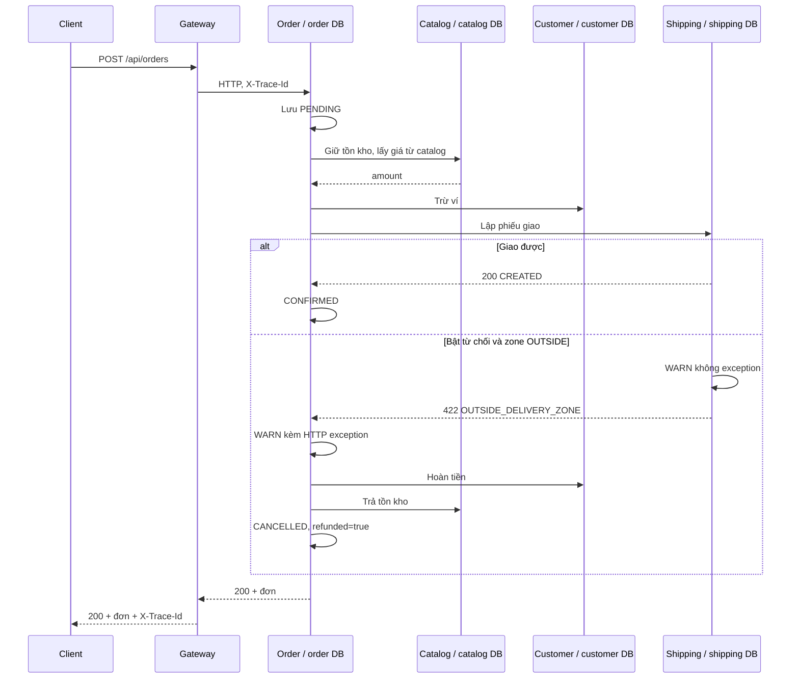

# MiniMart — giai đoạn 1

Năm ứng dụng Java Spring Boot, bốn database độc lập và một PostgreSQL. Giữ nguyên tài liệu gốc trong `docs/`. Chỉ triển khai phạm vi chạy cục bộ của ngày 1.

Phiên bản: **Java 21**, **Spring Boot 3.5.16**, **Maven 3.9.11**, **PostgreSQL 17.7** (image `postgres:17.7-alpine`). Java 21 tương thích với [yêu cầu Spring Boot 3.5](https://docs.spring.io/spring-boot/3.5/system-requirements.html). Đây là phiên bản được cố định để tái lập bài lab; đánh giá và cập nhật bản vá trước khi triển khai công khai.

```text
services/{gateway,catalog-service,customer-service,order-service,shipping-service}/
  pom.xml, Dockerfile, src/main/java/, src/main/resources/
deploy/docker-compose.yml
deploy/.env.example
deploy/postgres/init/01-databases.sh
scripts/smoke.py                    # kiểm thử HTTP qua gateway
scripts/verify-local-postgres.py    # phương án kiểm tra Windows khi thiếu Docker
```



Gateway là ứng dụng Spring MVC proxy HTTP với danh sách route được cho phép, không có JDBC hoặc database. Bốn service chỉ gọi nhau qua HTTP; mỗi tài khoản database không phải superuser, chỉ sở hữu database của mình. PostgreSQL đã thu hồi quyền PUBLIC trên cả bốn database. Chỉ gateway publish cổng `8080`; service và PostgreSQL nằm trên mạng Docker `backend` có `internal: true`.

| Service | Database | Tài khoản |
|---|---|---|
| catalog-service | minimart_catalog_db | catalog |
| customer-service | minimart_customer_db | customer |
| order-service | minimart_order_db | orders |
| shipping-service | minimart_shipping_db | shipping |

## Khởi động

Cần Docker Engine/Docker Desktop đang chạy với Linux containers và Docker Compose v2. Không cần Java/Maven trên host nếu build bằng Docker. Chạy từ thư mục gốc:

```sh
docker compose -f deploy/docker-compose.yml up -d --build
docker compose -f deploy/docker-compose.yml ps
```

Lệnh đầu dùng giá trị mặc định cho demo. Có thể sao chép `deploy/.env.example` thành `deploy/.env`, chỉnh cấu hình rồi dùng:

```sh
docker compose --env-file deploy/.env -f deploy/docker-compose.yml up -d --build
```

Dùng cùng `--env-file deploy/.env` cho các lệnh Compose tiếp theo nếu đã cấu hình file này. `depends_on` chờ PostgreSQL healthy; ứng dụng có thể cần thêm thời gian khởi động. Chờ `GET http://localhost:8080/api/products/1` trả 200 trước khi demo.

| Biến Compose | Mặc định / ý nghĩa |
|---|---|
| GATEWAY_PORT | 8080, cổng duy nhất công bố trên host |
| POSTGRES_PASSWORD | local_admin_change_me, mật khẩu quản trị chỉ cấp cho PostgreSQL |
| CATALOG_DB_PASSWORD | local_catalog_change_me |
| CUSTOMER_DB_PASSWORD | local_customer_change_me |
| ORDER_DB_PASSWORD | local_order_change_me |
| SHIPPING_DB_PASSWORD | local_shipping_change_me |

Mỗi ứng dụng hỗ trợ `PORT` (mặc định 8080); bốn service nhận `DB_URL`, `DB_USER`, `DB_PASSWORD`. URL mặc định là `jdbc:postgresql://postgres:5432/<database tương ứng>`. Gateway nhận `CATALOG_URL`, `CUSTOMER_URL`, `ORDER_URL`, `SHIPPING_URL`; order nhận ba URL nghiệp vụ còn lại. Mặc định là `http://<tên-service>:8080`.

Các mật khẩu mặc định chỉ dùng trên máy cá nhân. File init chỉ chạy khi volume mới; đổi biến mật khẩu không đổi tài khoản đã có trong volume. Giữ volume để giữ dữ liệu; không xóa volume nếu cần bảo toàn đơn hàng. Có thể dừng bằng `docker compose -f deploy/docker-compose.yml down`.

## Thử hai kịch bản

Schema và dữ liệu mẫu được tạo tự động khi service khởi động, không reset dữ liệu đã có: sản phẩm `1`, giá **25.000 VND**, tồn kho **1.000**; khách `1`, ví **10.000.000 VND**. Tiền dùng số nguyên VND, giá được lấy tại catalog. Mỗi lần POST tạo một đơn mới.

Các ví dụ `curl` dưới đây dùng Bash/Git Bash/WSL. Trong PowerShell có thể dùng `Invoke-RestMethod` hoặc lưu JSON vào file rồi gọi `curl.exe --data-binary @ten-file.json`.

Tắt từ chối trước khi thử thành công:

```sh
curl -fsS -X PUT http://localhost:8080/api/shipping/rejection -H 'Content-Type: application/json' -d '{"rejectOutsideZone":false}'
```

**1. Đặt đơn thành công:**

```sh
curl -i -X POST http://localhost:8080/api/orders -H 'Content-Type: application/json' -d '{"customerId":1,"productId":1,"quantity":2,"address":"Demo outside address","zone":"OUTSIDE"}'
```

Kỳ vọng `HTTP 200`, `status=CONFIRMED`, `amount=50000`, `refunded=false`; ví còn 9.950.000 và tồn kho 998 nếu dữ liệu còn mới.

Bật từ chối địa chỉ ngoài vùng và xem số dư trước khi đặt lại:

```sh
curl -fsS -X PUT http://localhost:8080/api/shipping/rejection -H 'Content-Type: application/json' -d '{"rejectOutsideZone":true}'
curl -fsS http://localhost:8080/api/customers/1
```

**2. Đặt đơn bị từ chối:**

```sh
curl -i -X POST http://localhost:8080/api/orders -H 'Content-Type: application/json' -d '{"customerId":1,"productId":1,"quantity":2,"address":"Demo outside address","zone":"OUTSIDE"}'
```

Kỳ vọng `HTTP 200`, `status=CANCELLED`, `refunded=true`, `reason=OUTSIDE_DELIVERY_ZONE`. Ví vẫn 9.950.000 và tồn kho vẫn 998 sau hai lần đặt trên. `zone=LOCAL` vẫn giao được khi bật từ chối; API này mô phỏng vùng giao, không tra bản đồ.

```sh
curl -fsS http://localhost:8080/api/customers/1
curl -fsS http://localhost:8080/api/products/1
curl -fsS http://localhost:8080/api/orders/THAY-BANG-ID-DON
docker compose -f deploy/docker-compose.yml logs shipping-service order-service
```

Response có `traceId` và header `X-Trace-Id`. Gửi header `X-Trace-Id` gồm đúng 32 ký tự hex thường để chủ động chọn mã; nếu thiếu/sai, gateway sinh mã mới. Mã này đi qua mọi lời gọi. Log JSON ECS có `@timestamp` (độ chính xác ít nhất mili giây), `service.name`, `log.level`, `trace.id`. Shipping ghi WARN nguyên nhân không có `error.stack_trace`; order ghi WARN hậu quả kèm `error.stack_trace` của HTTP 422. Không chèn độ trễ giả; lấy hiệu hai timestamp để đo thời gian lan truyền.

## Endpoint và giới hạn phạm vi

| Service | Endpoint luồng chính (nội bộ chỉ truy cập trong mạng Docker) | Endpoint phụ trợ |
|---|---|---|
| catalog | POST /internal/reservations; POST /internal/reservations/{id}/release | GET /api/products/{id} |
| customer | POST /internal/payments; POST /internal/payments/{id}/refund | GET /api/customers/{id} |
| order | POST /api/orders | GET /api/orders/{id} |
| shipping | POST /internal/shipments | PUT /api/shipping/rejection |

Mỗi service còn có `GET /actuator/health` và `GET /actuator/prometheus`: tổng cộng tối đa ba endpoint phụ trợ nếu tính cả hai endpoint vận hành. Gateway chỉ chuyển tiếp các API công khai ở bảng; không chuyển tiếp `/internal/**` hoặc Actuator của service. Không có endpoint reset hay CRUD thừa.

Kiểm tra metrics trong mạng nội bộ, không publish thêm cổng:

```sh
docker compose -f deploy/docker-compose.yml exec gateway wget -qO- http://catalog-service:8080/actuator/prometheus
```

Đổi hostname thành customer-service, order-service, shipping-service để kiểm tra đủ bốn. Prometheus server chưa được thêm để giữ đúng sáu container.

Kiểm tra phân quyền database: lệnh sau **phải thất bại** với `permission denied for database` (dùng mật khẩu catalog từ môi trường PostgreSQL):

```sh
docker compose -f deploy/docker-compose.yml exec postgres sh -c 'PGPASSWORD="$CATALOG_DB_PASSWORD" psql -h 127.0.0.1 -U catalog -d minimart_customer_db -c "SELECT 1"'
```

## Build và kiểm tra

Build bằng JDK 21 và Maven 3.9.11 từ gốc repo:

```sh
mvn -B clean verify
python scripts/smoke.py
```

`smoke.py` cần hệ thống Compose đang chạy; kiểm tra thành công, hoàn ví/trả tồn kho khi hủy, đọc lại đơn, vùng LOCAL, dữ liệu sai, route nội bộ bị chặn và tám đơn bị hủy đồng thời. Script tạo thêm dữ liệu demo, không reset dữ liệu.

Phương án kiểm thử không Docker, chỉ dùng trên Windows có sẵn PostgreSQL và JDK 21:

```powershell
$env:JAVA_HOME='C:/Program Files/Java/jdk-21'
mvn -B clean verify
python scripts/verify-local-postgres.py --pg-bin 'C:/Program Files/PostgreSQL/18/bin'
```

Script tạo cluster tạm dưới `.tools/`, bind `127.0.0.1:15432`, dùng chính SQL init Docker để tạo bốn database; kiểm tra toàn bộ 16 kết hợp tài khoản/database; chạy năm JAR ở cổng 18080–18084; xác minh metrics, trace, exception và chênh lệch timestamp. Script dừng các tiến trình do mình tạo sau kiểm thử; không sửa cluster PostgreSQL đang cài. Cần các cổng này còn trống.

Có thể kiểm thử nhanh bằng H2 qua profile Maven tùy chọn; bản build mặc định/Docker không chứa H2:

```sh
mvn -B -Plocal-test clean package
python scripts/smoke.py --local
```

Kết quả chạy thực tế và giới hạn môi trường được ghi trong [docs/PHASE1_VALIDATION.md](docs/PHASE1_VALIDATION.md).

## Điểm chưa làm

Chưa triển khai server, CI/GitHub Actions, registry, HTTPS, Prometheus/Grafana server hoặc EFK. Chưa có đăng nhập, giỏ hàng, giảm giá, thanh toán ngân hàng.

Điều phối hiện đồng bộ, dùng transaction cục bộ và khóa hàng cho tồn kho/ví; debit, refund, reserve và release hỗ trợ gọi lặp theo order ID. `PENDING` được commit trước lời gọi HTTP. Chỉ trả `CANCELLED/refunded=true` sau khi hoàn tiền và trả tồn kho thành công. Thiếu sản phẩm/thiếu ví trả 409, dữ liệu sai trả 400. Lỗi mạng/kết quả không chắc chắn giữ `PENDING` và trả 503 kèm order ID để đối soát; chưa có saga bền vững, retry/outbox hoặc tiến trình tự khôi phục sau crash. POST đặt hàng chưa có idempotency key cho client. Các hạn chế này cần giải quyết trước khi dùng thật.
