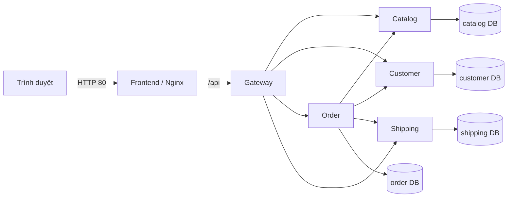

# MiniMart Online Retail

Năm ứng dụng Spring Boot, bốn database độc lập trong một PostgreSQL và frontend React + Vite. Giao diện bổ sung không thay đổi API, schema hoặc luồng nghiệp vụ. Tài liệu gốc nằm trong `docs/`.

Backend: Java 21, Spring Boot 3.5.16, Maven 3.9.11, PostgreSQL 17.7. Frontend: Node.js 22.12+, React 19, Vite 7. Các thư viện JavaScript được khóa trong `frontend/package-lock.json`.

```text
frontend/                          # React, CSS responsive, kiểm thử, Dockerfile, Nginx
services/gateway/
services/catalog-service/
services/customer-service/
services/order-service/
services/shipping-service/
deploy/docker-compose.yml
deploy/.env.example
deploy/postgres/init/01-databases.sh
scripts/smoke.py
scripts/verify-local-postgres.py
```

## Kiến trúc và nghiệp vụ



Chỉ Nginx publish cổng HTTP 80. Trình duyệt gọi `/api` cùng origin; Nginx chuyển nguyên đường dẫn tới gateway qua mạng Docker `edge`. Gateway vẫn lọc danh sách route; không publish cổng host. Bốn service và PostgreSQL ở mạng `backend` có `internal: true`. Có bảy container, gồm frontend, năm ứng dụng Java và PostgreSQL.

Order lưu `PENDING`, giữ tồn kho qua Catalog, trừ ví qua Customer rồi lập phiếu qua Shipping. Thành công trả `CONFIRMED`. Khi giao ngoài vùng bị từ chối, Order hoàn ví và trả tồn kho rồi trả `CANCELLED`, `refunded=true`, `reason=OUTSIDE_DELIVERY_ZONE`. Không đổi luồng này trong phiên bản web.

Mỗi service sở hữu database và tài khoản riêng: catalog/minimart_catalog_db, customer/minimart_customer_db, orders/minimart_order_db, shipping/minimart_shipping_db. Gateway không dùng JDBC. Mọi giao tiếp nghiệp vụ liên service đi qua HTTP.

## Chạy toàn bộ bằng Docker Compose

Cần Docker Engine/Docker Desktop chạy Linux containers và Compose v2. Từ thư mục gốc:

```sh
docker compose -f deploy/docker-compose.yml config --quiet
docker compose -f deploy/docker-compose.yml build
docker compose -f deploy/docker-compose.yml up -d
docker compose -f deploy/docker-compose.yml ps
curl -fsS http://localhost/healthz
curl -fsS http://localhost/api/products/1
```

Mở **http://localhost**. `/healthz` kiểm tra Nginx; chờ API sản phẩm trả 200 để xác nhận backend sẵn sàng. `depends_on` chờ PostgreSQL healthy nhưng các ứng dụng Java vẫn cần thời gian khởi động. Giao diện có nút tải lại khi API chưa sẵn sàng.

Cấu hình riêng: sao chép `deploy/.env.example` thành `deploy/.env` và chỉnh trên máy chạy. File này được Git bỏ qua. Khi dùng file này, thêm `--env-file deploy/.env` vào mọi lệnh Compose:

```sh
docker compose --env-file deploy/.env -f deploy/docker-compose.yml up -d --build
```

| Biến | Ý nghĩa |
|---|---|
| HTTP_PORT | Cổng HTTP host, mặc định 80, thay GATEWAY_PORT cũ |
| FRONTEND_API_URL | Origin gateway cho Nginx, mặc định http://gateway:8080 |
| POSTGRES_PASSWORD | Mật khẩu quản trị PostgreSQL |
| CATALOG_DB_PASSWORD | Mật khẩu tài khoản Catalog |
| CUSTOMER_DB_PASSWORD | Mật khẩu tài khoản Customer |
| ORDER_DB_PASSWORD | Mật khẩu tài khoản Order |
| SHIPPING_DB_PASSWORD | Mật khẩu tài khoản Shipping |

Các giá trị demo trong cấu hình hiện có chỉ dùng trên máy cá nhân. Không ghi mật khẩu thực, token, khóa AWS, khóa SSH hoặc `deploy/.env` vào Git. Không xuất `docker compose config` đầy đủ ra log dùng chung; dùng `config --quiet` để kiểm tra mà không lộ biến môi trường. Frontend build không copy `.env` vào image.

`FRONTEND_API_URL` được truyền thành `API_URL` cho template Nginx khi container khởi động; recreate frontend để áp dụng thay đổi, không cần build lại. Chỉ dùng origin, không thêm `/api` hoặc dấu `/` cuối. Không trỏ về public origin của chính frontend vì sẽ tạo vòng lặp. Mặc định Compose dùng gateway nội bộ, tránh CORS và không đi vòng qua IP công khai.

Các ứng dụng vẫn hỗ trợ `PORT` (8080), `DB_URL`, `DB_USER`, `DB_PASSWORD`; gateway nhận `CATALOG_URL`, `CUSTOMER_URL`, `ORDER_URL`, `SHIPPING_URL`. Order nhận URL của ba service nghiệp vụ. Đường dẫn mặc định sử dụng DNS service của Compose.

Init database chỉ chạy trên volume mới. Đổi biến mật khẩu không đổi tài khoản đã có trong database. Giữ nguyên volume để giữ đơn hàng, tồn kho và ví. Dừng bằng `docker compose -f deploy/docker-compose.yml down`; không dùng `down -v` nếu cần giữ dữ liệu.

## Chạy frontend local

Cần Node.js 22.12+ và npm. Từ gốc repo:

```sh
cd frontend
npm ci
cp .env.example .env
npm run dev
```

Trên PowerShell dùng `Copy-Item .env.example .env`; dùng `npm.cmd` nếu `npm.ps1` bị chặn bởi execution policy. Mở URL Vite in ra, thường là **http://127.0.0.1:5173**.

`API_URL` cấu hình origin gateway tại Vite proxy, mặc định demo **http://54.79.162.59**. Trình duyệt luôn gọi `/api` cùng origin nên không cần sửa CORS ở Java. Để dùng backend Compose trên máy, đặt `API_URL=http://localhost` trong `frontend/.env`, rồi khởi động lại Vite. URL này là thông tin công khai, không chứa thông tin bí mật. Không đặt đơn thử vào demo từ xa nếu chưa xác nhận đó là môi trường test.

```sh
npm test
npm run build
npm run preview
```

Build sinh `frontend/dist`. Preview ở cổng 4173 chỉ xem bản tĩnh, không có proxy API; kiểm tra luồng API bằng Vite dev hoặc Compose/Nginx.

## Giao diện và hợp đồng API

Trang chính tải `GET /api/products/1`: `{id, name, price, stock}`; có trạng thái tải, lỗi, nút tải lại. Form tiếng Việt responsive trên máy tính và điện thoại, điều hướng được bằng bàn phím. Không có đăng nhập, giỏ hàng hoặc thanh toán thật; ví demo của backend vẫn được sử dụng.

`POST /api/orders` gửi JSON:

```json
{"customerId":1,"productId":1,"quantity":2,"address":"12 Nguyễn Trãi","zone":"LOCAL"}
```

Mã khách hàng/sản phẩm là số nguyên dương; số lượng 1–100; địa chỉ không trống, tối đa 300 ký tự; zone là LOCAL hoặc OUTSIDE. Giá chính thức do Catalog tính. Dữ liệu mẫu ban đầu: sản phẩm 1 giá 25.000 VND, tồn kho 1.000; khách 1 có ví 10.000.000 VND. Dữ liệu seed không reset dữ liệu đã có.

Response đơn: `{id, status, amount, refunded, reason, traceId}`. CONFIRMED hiển thị thành công. CANCELLED hiển thị trạng thái hoàn tiền và nguyên nhân. Lỗi API/mạng giữ dữ liệu trong form. Lỗi 503 giữ chi tiết orderId để đối soát. Không tự retry POST vì chưa có idempotency key; mất kết nối có thể đã tạo đơn, cần kiểm tra trước khi gửi lại. Form không lưu địa chỉ qua lần tải lại trang.

| API qua gateway | Công dụng |
|---|---|
| GET /api/products/{id} | Xem sản phẩm |
| GET /api/customers/{id} | Xem ví demo |
| POST /api/orders | Tạo đơn |
| GET /api/orders/{uuid} | Đọc lại đơn |
| PUT /api/shipping/rejection | Cấu hình rejectOutsideZone cho demo |

Các API nội bộ giữ nguyên: Catalog reservations/release, Customer payments/refund, Shipping shipments. Gateway không chuyển tiếp `/internal/**` hoặc Actuator của các service. Mỗi ứng dụng có health/prometheus nội bộ. Ví dụ đọc metrics không mở thêm cổng:

```sh
docker compose -f deploy/docker-compose.yml exec gateway wget -qO- http://catalog-service:8080/actuator/prometheus
```

Response có `X-Trace-Id`; đơn có `traceId`. Header đầu vào hợp lệ gồm 32 ký tự hex thường, nếu thiếu/sai gateway sinh mới. Log ECS JSON có timestamp, service.name, log.level, trace.id. Shipping WARN nguyên nhân không có stack trace; Order WARN hậu quả kèm HTTP exception. Không chèn độ trễ giả.

## Kiểm tra giao diện và backend

`npm test` dùng HTTP giả lập, không gọi EC2 và không sửa dữ liệu production. Các nhánh kiểm tra: tải/lỗi/tải lại sản phẩm, JSON và kiểu số POST, CONFIRMED, CANCELLED/refunded/reason, lỗi 400/409/503, lỗi mạng, giữ dữ liệu, chặn gửi lặp, giới hạn số lượng.

Thử thủ công trên local/test: màn hình 375px và desktop; điều hướng Tab; tải lại sản phẩm; đặt LOCAL để thấy CONFIRMED. Để kiểm tra hủy đơn, trên môi trường test chạy:

```sh
curl -fsS -X PUT http://localhost/api/shipping/rejection -H 'Content-Type: application/json' -d '{"rejectOutsideZone":true}'
```

Chọn OUTSIDE trên form và đặt đơn, kiểm tra CANCELLED, refunded=true, reason=OUTSIDE_DELIVERY_ZONE. Sau kiểm tra đặt lại rejectOutsideZone=false. Dừng gateway để xem lỗi và xác nhận địa chỉ còn nguyên. Ví dụ curl dùng Bash/Git Bash/WSL; PowerShell dùng Invoke-RestMethod hoặc curl.exe với JSON từ file.

Kiểm thử backend (JDK 21 và Maven 3.9.11):

```sh
mvn -B clean verify
python scripts/smoke.py --base http://localhost
```

Smoke cần Compose đang chạy, kiểm tra thành công, hoàn ví/tồn kho, đọc đơn, LOCAL, dữ liệu sai, route nội bộ bị chặn và các đơn hủy đồng thời. Script làm thay đổi dữ liệu test, không chạy trên production.

Có thể chạy H2 biệt lập khi không có Docker:

```sh
mvn -B -Plocal-test clean package
python scripts/smoke.py --local
```

Hoặc trên Windows có PostgreSQL và JDK 21:

```powershell
$env:JAVA_HOME='C:/Program Files/Java/jdk-21'
mvn -B clean verify
python scripts/verify-local-postgres.py --pg-bin 'C:/Program Files/PostgreSQL/18/bin'
```

Script tạo cluster tạm dưới `.tools/`, dùng cổng 15432 và năm ứng dụng ở 18080–18084; dừng các tiến trình nó tạo sau kiểm tra. Chi tiết backend ở [docs/PHASE1_VALIDATION.md](docs/PHASE1_VALIDATION.md). Kết quả phần web ở [docs/FRONTEND_VALIDATION.md](docs/FRONTEND_VALIDATION.md).

## Triển khai EC2

1. Trên EC2 có Docker Engine và Compose v2, lấy source repo tại commit đã kiểm tra. Giữ volume PostgreSQL hiện tại và bản sao lưu theo quy trình vận hành.
2. Tạo `deploy/.env` trực tiếp trên server từ mẫu, nhập các giá trị riêng của môi trường. Database đã tồn tại phải giữ thông tin đăng nhập đang dùng; đổi biến môi trường không đổi mật khẩu trong volume. Không commit thông tin bí mật.
3. Đảm bảo cổng 80 còn trống. Cho phép inbound TCP 80 trong Security Group/firewall; giữ SSH theo phạm vi quản trị hiện có. Đóng inbound 8080/5432, không publish service/database.
4. Từ thư mục gốc chạy:

```sh
docker compose --env-file deploy/.env -f deploy/docker-compose.yml config --quiet
docker compose --env-file deploy/.env -f deploy/docker-compose.yml build
docker compose --env-file deploy/.env -f deploy/docker-compose.yml up -d
docker compose --env-file deploy/.env -f deploy/docker-compose.yml ps
curl -fsS http://localhost/healthz
curl -fsS http://localhost/api/products/1
```

5. Mở **http://<EC2_PUBLIC_IP>**. IP demo hiện tại được cấu hình trong `frontend/.env.example`. Chỉ kiểm tra GET trên production; thử POST tại môi trường test riêng. Khi lỗi, xem `logs frontend gateway` và trạng thái service. Không xóa volume hoặc chạy `down -v`.

## Giới hạn hiện tại

Chưa tự triển khai server, CI/registry, HTTPS, xác thực, Prometheus/Grafana server hoặc EFK. Cần bổ sung trước khi sử dụng thật. Order dùng điều phối đồng bộ, transaction cục bộ và khóa tồn kho/ví; reserve/debit/refund/release có thể gọi lặp theo order ID. Chỉ trả CANCELLED/refunded=true sau hoàn ví và trả kho thành công. Thiếu hàng/ví trả 409, dữ liệu sai trả 400. Kết quả chưa chắc chắn giữ PENDING, trả 503 và order ID. Chưa có saga bền vững, retry/outbox hoặc tự khôi phục sau crash; POST chưa có idempotency key cho client.
